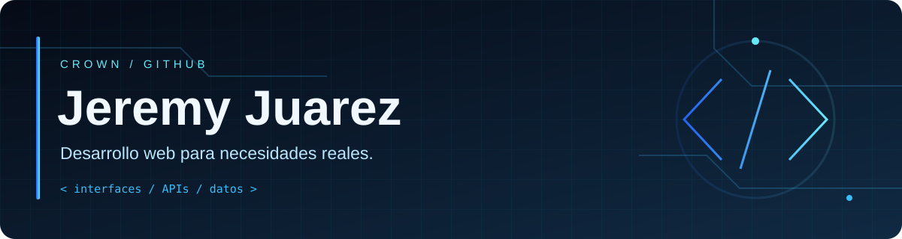

  

<h1 align="center">Hola, soy Jeremy Juarez 👋</h1>

<strong>Construyo aplicaciones web para resolver necesidades reales.</strong> Puntos de venta · Inventarios · Gestión de clientes

<a href="https://github.com/TheSilencess?tab=repositories">Explora mis proyectos</a> · <a href="https://github.com/TheSilencess/portafolio">Mi portafolio</a>

## ⚡ Sobre mí

Soy **Jeremy Juarez**, también conocido como **crown**. En mis repositorios encontrarás sistemas de negocio y proyectos web: desde un punto de venta para ropa y accesorios hasta herramientas de inventario y gestión de clientes, envíos y rutas.

Me gusta conectar interfaces con APIs y bases de datos. Y sí: **C# 4 life** 💙

## 🧩 Tecnologías en mis proyectos

  
  
  
  
  
  
  
  

## 🚀 Proyectos destacados

| Proyecto | Qué encontrarás | Tecnologías verificadas |
| :--- | :--- | :--- |
| **[TutiMami POS](https://github.com/TheSilencess/sistema-pos)** | Punto de venta web para una tienda de ropa y accesorios. | TypeScript · Node.js · Prisma · PostgreSQL |
| **[Bodega](https://github.com/TheSilencess/sistema-inventario)** | Inventario con variantes, movimientos de stock y reportes. | React · Vite · Express · TypeScript · Prisma · PostgreSQL |
| **[Gift](https://github.com/TheSilencess/sistema-gestion-clientes)** | Gestión de clientes, envíos y rutas para comercio en línea. | Next.js · React · TypeScript · Prisma · PostgreSQL |
| **[Fixer Backend](https://github.com/TheSilencess/Fixer-Backend)** | Proyecto para solicitar servicios técnicos a domicilio, con una propuesta de experiencia tipo Uber. | Consulta el repositorio |

## 📊 Mi actividad en GitHub

  
  
  

<a href="https://github.com/TheSilencess?tab=overview">Ver mi calendario de contribuciones y actividad</a>

Datos públicos de GitHub mediante Shields.io; las métricas pueden tardar en actualizarse por caché.

